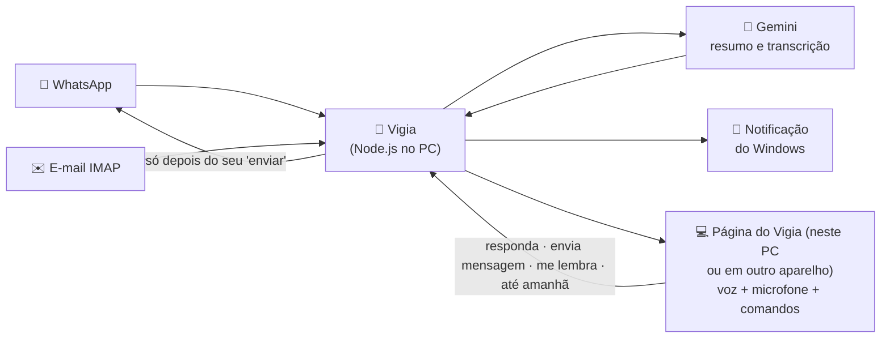
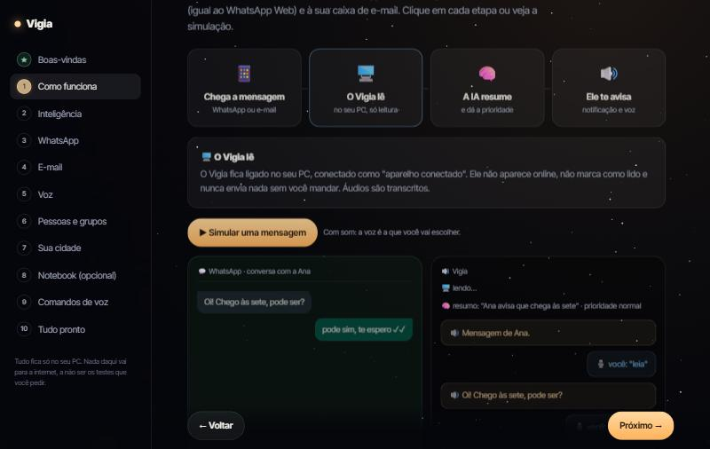

<div align="center">

# 🔮 Vigia

### Seu assistente de voz para WhatsApp e e-mail, rodando no seu próprio PC

Ele lê cada mensagem assim que chega, resume com IA, avisa no Windows e **fala em voz alta**.<br>
Você responde **falando**, e nada sai sem a sua confirmação.

<br>

[](https://github.com/eudollyn/vigia/archive/refs/heads/main.zip)

<br>


</div>

---

## ✨ O que ele faz

| | Recurso | Como funciona |
|---|---|---|
| 💬 | **Lê o WhatsApp** | Conecta como "aparelho conectado" (QR code). Não aparece online e não marca nada como lido. |
| ✉️ | **Lê o e-mail** | IMAP com aviso instantâneo (IDLE). Newsletter e propaganda ficam em silêncio. |
| 🧠 | **Resume com IA** | Cada mensagem vira uma frase curta, com prioridade *urgente*, *normal* ou *baixa*. |
| 🔊 | **Fala em voz alta** | Vozes neurais grátis (Francisca, Thalita, Antonio), com a voz do Windows como reserva. |
| 🎧 | **Transcreve áudios** | Áudios do WhatsApp de até 5 minutos viram texto e resumo. |
| 🗣️ | **Responde por voz** | "Responda" → você dita → ele lê de volta → só envia com "enviar". |
| 📨 | **Envia por voz** | "Envia mensagem para o Thiago dizendo que chego às sete": acha o contato pelo **som do nome**. |
| ⏰ | **Lembretes** | "Me lembra às três de ligar pro cliente", "daqui a 20 minutos", "amanhã de manhã". |
| ☀️ | **Bom dia** | Saudação, data, previsão do tempo e quem ficou sem resposta no WhatsApp. |
| 🌙 | **"Até amanhã"** | Desliga o PC em 15 s (diga "cancela" para desfazer). |
| 💻 | **Página do Vigia** | Abre sozinha no navegador do PC: fala, ouve os comandos e mostra os avisos. Quer usar de outro aparelho (notebook, tablet)? Também dá. |
| 🎵 | **Modo música** | Pausa os comandos contínuos, aumenta a voz e adapta o microfone ao som da música. |
| 🔒 | **Contatos privados** | Para quem você escolher, ele diz só "Mensagem de Fulano", sem ler o conteúdo. |
| 📦 | **Respeita as arquivadas** | Conversas arquivadas no WhatsApp ficam em silêncio. Arquivou ou desarquivou no celular, ele atualiza na hora. |
| 🔤 | **Pronúncia certa** | Ensine como falar nomes difíceis (`Thalyta=Talíta`). Só a voz muda, a tela continua igual. |
| 💸 | **Econômico** | Grupos de baixa prioridade não gastam a cota da IA: só entram no resumo de hora em hora. |
| 🙊 | **Aviso curto** | Diz só *"Mensagem de Ana, no grupo X"*. O conteúdo só é lido quando você diz **"leia"**. |
| 🎙️ | **Áudio com a sua voz** | "Mande um áudio para a Ana": grava, limpa o ruído, corta o silêncio e envia como áudio de voz do WhatsApp. |
| 🔗 | **Links** | *"Ana mandou um link"* → diga **"abra o link"** e ele abre no navegador do PC (só endereços http/https). |
| ✋ | **"Cancelar" a qualquer hora** | Para na hora o que estiver falando, ouvindo ou gravando. Nada é enviado. |
| 🔁 | **Nada se perde** | Recupera o que chegou com o PC desligado e avisa tudo de uma vez: *"Enquanto eu estava desligado, chegaram mensagens de…"*. |
| 💤 | **Liga o PC pelo notebook** | *Opcional, para quem também usa um notebook:* abriu a tampa com o PC desligado? Ele fala *"Ligando o PC"* e liga o PC pela rede (Wake-on-LAN). |
| 🧵 | **Sem metralhadora de avisos** | Mensagens picadas viram um aviso só. Depois de avisar alguém, espera 2 min (menos se você estiver conversando com a pessoa) e diz *"Ana mandou mais 6 mensagens"*. Quer silêncio? *"Silencia a Ana por duas horas"*. |
| 🔎 | **Pergunte às suas mensagens** | *"O que a Ana falou sobre o carro?"*, *"qual o valor que o Bruno passou?"*: procura no WhatsApp e no e-mail dos últimos 7 dias e responde falando. |
| 📌 | **"Me lembra disso"** | Logo depois de um aviso: *"me lembra disso às três"*. O lembrete guarda de quem era a mensagem e o que ela dizia. |
| ✍️ | **Pontua o que você dita** | "oi tudo bem chego às sete pode ser" vira *"Oi, tudo bem? Chego às sete, pode ser?"* antes de enviar. |
| 🪄 | **Assistente de configuração** | Uma página no navegador explica, testa e configura tudo. Nada de editar arquivo. |
| 🗨️ | **Entende gírias** | Abreviações de chat (vc, blz, pfv, kkkk…) são lidas por extenso. |

---

## 🧭 Como funciona



---

## 🚀 Instalação em 3 passos

> **Precisa de:** Windows 10/11, conta Google (para a chave grátis do Gemini) e o WhatsApp no celular.

**1. Baixe e extraia**
Clique no botão verde **⬇ BAIXAR O VIGIA** lá em cima e extraia o `.zip` numa pasta, por exemplo `Documentos\Vigia`.

**2. Rode o instalador**
Dê dois cliques em **`INSTALAR.bat`**. Ele confere o **Node.js** e o **ffmpeg** (e oferece instalar o que faltar), instala as dependências e, no fim, **abre o assistente de configuração no navegador**.

**3. Siga o assistente** ✨
Uma página passo a passo explica como o Vigia funciona e configura tudo com você, sem editar arquivo nenhum. Veja abaixo.

Para mudar a configuração depois, rode o **`CONFIGURAR.bat`**. Para ligar o Vigia na mão, use o **`INICIAR.bat`**.

---

## 🪄 Assistente de configuração

<div align="center">

</div>

| Passo | O que você faz ali |
|---|---|
| **Como funciona** | Clica em cada etapa (mensagem → Vigia → IA → voz) e assiste a uma **simulação com som**: chega a mensagem da Ana, o Vigia avisa, você diz "leia" e "responda", e a resposta aparece no WhatsApp. |
| **Inteligência** | Abre o Google AI Studio, cola a chave e clica em **Testar a chave**: ele diz na hora se a chave funciona, é inválida ou se a cota acabou. |
| **WhatsApp** | O **QR code aparece na própria página**. Escaneia pelo celular e pronto. |
| **E-mail** | Escolhe o provedor (Gmail, Outlook, Yahoo, iCloud, Locaweb, Hostinger, Zoho…): o servidor é preenchido sozinho, com a dica de **senha de app** quando precisa. **Testar a conexão** mostra quantos e-mails tem na caixa ou o que deu errado. |
| **Voz** | **Ouve** a Francisca, a Thalita e o Antonio antes de escolher, digita como quer ser chamado e ouve a saudação. Escolhe entre "só diz de quem é" ou "já lê tudo", e o horário de silêncio. |
| **Pessoas e grupos** | Contatos privados, grupos de baixa prioridade e pronúncia de nomes, como etiquetas. Dá para **ouvir** como um nome vai ser falado. |
| **Sua cidade** | Procura a cidade, vê a previsão de hoje e ouve como o Vigia vai falar o tempo. |
| **Página do Vigia** | Escolhe onde usar: **neste PC** (abre sozinha, nada a configurar) ou **em outro aparelho** da rede, com o passo a passo do Chrome e botões de copiar. |
| **Comandos de voz** | Lista com busca e filtros (mensagens, áudios, links, dia a dia, controle). |
| **Tudo pronto** | Confere o que está configurado e o que falta, liga "iniciar com o Windows" e liga o Vigia. |

<div align="center">

</div>

> 🔐 O assistente só abre neste PC (endereço `127.0.0.1`), com uma chave nova a cada vez. As senhas ficam só no seu `.env` e nunca aparecem de volta na página.

---

## 💻 A página do Vigia

É onde o Vigia **fala com você, ouve os comandos de voz e mostra os avisos**. Ela abre no navegador e funciona de dois jeitos:

**Neste PC (padrão)**
Não precisa fazer nada: quando o Vigia liga, a página abre sozinha no navegador (`ABRIR_PAGINA=1`). Clique em **Ativar som e microfone** e permita o microfone. Use o **Chrome** ou o **Edge**. Se fechar sem querer, o link fica em `dados/LINK-DA-PAGINA.txt` (algo como `http://localhost:8765/?k=chave-secreta`).

<details>
<summary><b>Em outro aparelho (notebook, tablet) — opcional</b></summary>

Útil quando o PC fica longe ou não tem caixa de som. Na configuração, escolha "Em outro aparelho" (`ABRIR_PAGINA=0`).

1. Abra no Chrome do outro aparelho (mesma rede Wi-Fi) o link de rede de `dados/LINK-DA-PAGINA.txt`, algo como `http://192.168.0.10:8765/?k=chave-secreta`.
2. **Para liberar o microfone** (uma vez só), porque fora do próprio PC o Chrome só libera microfone em HTTPS:
   - abra `chrome://flags/#unsafely-treat-insecure-origin-as-secure`;
   - mude para **Enabled** e coloque o endereço do PC, por exemplo `http://192.168.0.10:8765`;
   - clique em **Relaunch**.
3. Se o Windows do PC perguntar, permita o **Node.js** na rede privada.
</details>

A página tem céu animado, uma esfera que reage à voz, cartões com os últimos avisos, os botões **Responder**, **🎵 Modo música** e **🌙 Até amanhã** (segure para confirmar).

---

## 🗣️ Comandos de voz

| Diga | O que acontece |
|---|---|
| **"Responda"** | Responde a última mensagem do WhatsApp (dos últimos 15 min). |
| **"Responda: chego às sete"** | Já dita a resposta junto. |
| **"Envia mensagem para o Thiago"** | Pergunta *"Qual mensagem?"*, lê de volta e espera o "enviar". |
| **"Envia mensagem para o Thiago dizendo que…"** | Vai direto para a confirmação. |
| **"Me lembra às três de…"** | Cria um lembrete. Também aceita *"daqui a 20 minutos"* e *"amanhã de manhã"*. |
| **"Leia"** | Lê a última mensagem avisada. |
| **"Leia a última mensagem da Ana"** | Lê a última mensagem daquela pessoa (ou grupo), mesmo de horas atrás. |
| **"Ouça o áudio"** / **"Ouça o último áudio da Ana"** | Toca o áudio original da pessoa. |
| **"Responda a Ana"** / **"Responda a Ana com áudio"** | Responde por texto ditado ou gravando a sua voz. |
| **"Mande um áudio para a Ana"** | Grava e envia um áudio de voz. Termina sozinho depois de 3 s de silêncio. |
| **"Abra o link"** / **"Abra o link que a Ana mandou"** | Abre o link no navegador do PC. |
| **"O que a Ana falou sobre o carro?"** / **"Procura nas mensagens o endereço da festa"** | Procura nas mensagens dos últimos 7 dias e responde falando (quem falou e quando). |
| **"Me lembra disso às três"** / **"…daqui a meia hora"** | Lembrete com a última mensagem avisada: de quem era e o que dizia. |
| **"Que horas são?"** | Diz a hora e a data. |
| **"Vai chover hoje?"** / **"Como está o tempo?"** | Temperatura de agora e previsão do dia. |
| **"Lê meus e-mails de hoje"** | Resumo dos e-mails de pessoas que chegaram hoje (sem propaganda). |
| **"Silencia a Ana"** / **"…por duas horas"** / **"…o dia todo"** | Mensagens dela só na tela, sem voz (padrão: 1 hora). |
| **"Volta a avisar a Ana"** | Tira o silêncio e diz quantas mensagens chegaram. |
| **"Repete"** | Fala de novo a última coisa que disse. |
| **"Até amanhã"** | Despede-se e desliga o PC em 15 s. |
| **"Cancelar"** | Em qualquer momento e em qualquer frase: para tudo o que está em andamento (e desfaz o "até amanhã"). |
| **"Enviar"** / **"Pode mandar"** / **"Sim"** | Confirma o envio. |

> 🛡️ **Segurança contra disparo acidental:** "até amanhã" só vale como a **frase inteira** e "responda" sozinho só como **frase curta**. "Vamos conversar até amanhã" ou "tchau, até amanhã, pessoal" de uma visita não desligam nada.

---

## 💤 Ligar o PC abrindo o notebook (opcional)

Com o PC desligado, o Vigia também está desligado. Por isso quem liga o PC é um programinha que fica no **notebook**:
ao desbloquear ou abrir a tampa, se o PC não responder, ele fala *"Ligando o PC"* (com a mesma voz do Vigia) e manda o
**pacote mágico** de Wake-on-LAN. O PC liga, o Vigia inicia, a página do notebook reconecta e você ouve o bom dia.

1. No PC: placa de rede com **Wake on Magic Packet** e **Shutdown Wake-On-LAN** ativados (Gerenciador de Dispositivos → placa de rede → Avançado) e Wake-on-LAN ligado na BIOS. O "até amanhã" já faz o desligamento completo.
2. No notebook, com o Vigia ligado, baixe o instalador já preenchido com os dados do seu PC:
   `http://IP-DO-PC:8765/notebook/ligar-pc.zip?k=sua-chave` (o mesmo link da página, trocando `/` por `/notebook/ligar-pc.zip`).
3. Extraia e rode **instalar.bat** (não precisa ser administrador). Para remover: **desinstalar.bat**.

O registro fica em `%LOCALAPPDATA%\VigiaLigarPC\ligar-pc.log`.

---

## ⚙️ Configuração (`.env`)

| Variável | Para quê | Exemplo |
|---|---|---|
| `GEMINI_API_KEY` | Resumo, transcrição e lembretes | `AIza…` |
| `EMAIL_USUARIO` / `EMAIL_SENHA` / `IMAP_HOST` | Leitor de e-mail | `imap.gmail.com` |
| `WHATSAPP` | Liga ou desliga o WhatsApp | `1` |
| `VOZ_MICROSOFT` | Voz da assistente | `pt-BR-FranciscaNeural` |
| `SAUDACAO_NOME` | Como ela te chama | `Sr. João` |
| `SILENCIO` | Horário sem voz (só notificação) | `22-7` |
| `BAIXA_PRIORIDADE` | Grupos que só entram no resumo de hora em hora | `Promoções,Condomínio` |
| `AGRUPAR_SEGUNDOS` | Junta mensagens picadas até a pessoa parar de mandar | `20` |
| `PAUSA_MESMA_PESSOA_MIN` | Minutos sem falar da mesma pessoa depois de um aviso | `5` |
| `PRIVADOS` | Contatos cujo conteúdo não é lido em voz alta | `Mãe,Amor` |
| `PRONUNCIA` | Como a voz fala certos nomes (só na fala) | `Thalyta=Talíta;Joao=João` |
| `ABRIR_PAGINA` | Abre a página do Vigia neste PC ao ligar (0 = você usa em outro aparelho) | `1` |
| `SAIDA_VOZ` | Onde a voz toca (`notebook` = na página, onde ela estiver) | `notebook` · `pc` · `ambos` |
| `MICROFONE_ORIGEM` | De onde vem a sua voz (`notebook` = microfone da página) | `notebook` · `pc` |
| `CLIMA_CIDADE` / `CLIMA_LAT` / `CLIMA_LON` | Previsão do bom dia | `Recife` / `-8.05` / `-34.9` |

---

## 🔐 Privacidade e segurança

- **Suas senhas e chaves ficam só no `.env`**, que está no `.gitignore` e nunca é enviado.
- **Login do WhatsApp, contatos e histórico** ficam em `dados/`, também fora do Git. Não compartilhe essa pasta.
- **Nada é enviado sem confirmação falada.** O Vigia não responde nem encaminha nada sozinho.
- **O que vai para fora do seu PC:** o texto das mensagens e os áudios vão para o **Google Gemini** (resumo e transcrição). Os comandos de voz da página usam o **reconhecimento de voz do Chrome/Edge**, que também passa por servidores do Google (ou da Microsoft, no Edge). A previsão do tempo usa a **Open-Meteo** (só a cidade).
- A página do Vigia só abre com a **chave secreta** do link.

> ⚠️ **Aviso:** a conexão com o WhatsApp usa a biblioteca não oficial [Baileys](https://github.com/WhiskeySockets/Baileys), o mesmo protocolo do WhatsApp Web. Use com moderação e por sua conta e risco: o WhatsApp não aprova clientes não oficiais.

---

## 🛠️ Solução de problemas

<details>
<summary><b>Não aparece o QR code / o WhatsApp desconectou</b></summary>

Apague a pasta `dados/whatsapp-sessao` e rode o `INICIAR.bat` de novo para gerar outro QR.
</details>

<details>
<summary><b>E-mail: "usuário ou senha recusados"</b></summary>

Confira o domínio do e-mail e o `IMAP_HOST`. No Gmail, use uma **senha de app**. Senhas com `#` funcionam normalmente, desde que fiquem entre aspas: `EMAIL_SENHA="abc#123"`.
</details>

<details>
<summary><b>A voz parou / "cota excedida"</b></summary>

A voz padrão (Microsoft) é grátis e não tem cota. Se você trocou para `VOZ_MOTOR=google`, a cota grátis do Gemini TTS é pequena: volte para `microsoft`.
</details>

<details>
<summary><b>"Gemini 429: You exceeded your current quota"</b></summary>

A cota grátis do dia acabou. O Vigia continua funcionando com o **resumo simples** (o começo da mensagem) e volta sozinho quando a cota renova. Para gastar menos, coloque os grupos barulhentos (promoções, por exemplo) em `BAIXA_PRIORIDADE`: eles não usam a IA.
</details>

<details>
<summary><b>Uma conversa arquivada ainda avisa</b></summary>

A lista de arquivadas é lida a cada vez que o Vigia conecta (o log mostra *"N conversas arquivadas"*). Reinicie o Vigia; arquivamentos feitos com ele ligado valem na hora.
</details>

<details>
<summary><b>A página do Vigia não abre</b></summary>

Neste PC: abra o link de `dados/LINK-DA-PAGINA.txt` com o Vigia ligado. Em outro aparelho: ele precisa estar na mesma rede do PC, e o **Node.js** precisa estar liberado no Firewall do Windows (rede privada).
</details>

<details>
<summary><b>O microfone da página não funciona</b></summary>

Neste PC: permita o microfone quando o navegador perguntar (cadeado ao lado do endereço → Microfone → Permitir). Em outro aparelho: faça o passo da flag `unsafely-treat-insecure-origin-as-secure` e recarregue. A página precisa mostrar "🎙️ Microfone".
</details>

<details>
<summary><b>Testar sem esperar mensagem</b></summary>

```bash
npm run teste-aviso        # notificação + voz de exemplo
npm run teste-microfone    # grava uma frase e mostra o que entendeu
```
</details>

---

## 📁 Estrutura

```
vigia/
├── INSTALAR.bat            # instalador guiado
├── INICIAR.bat             # liga o Vigia
├── CONFIGURAR.bat          # abre o assistente de configuração no navegador
├── docs/                   # imagens do README
├── .env.example            # modelo de configuração
├── scripts/                # notificação, voz, inicialização com o Windows
├── notebook/               # "Ligar o PC" (Wake-on-LAN) que roda no notebook
└── src/
    ├── index.js            # ponto de entrada
    ├── whatsapp.js         # leitura, áudios, busca de contatos por som
    ├── email.js            # IMAP com IDLE
    ├── resumo.js           # resumo e prioridade (Gemini / Claude / simples)
    ├── avisos.js           # notificação, fila de voz, privacidade
    ├── conversa.js         # responder e enviar por voz, com confirmação
    ├── comandos.js         # comandos de voz, lembretes, bom dia
    ├── girias.js           # abreviações e gírias lidas por extenso
    ├── ligar-pc.js         # monta o instalador do "Ligar o PC" para o notebook
    ├── historico.js        # perguntas sobre as mensagens dos últimos dias
    ├── pontuar.js          # pontuação do texto ditado (vírgula, ponto, interrogação)
    ├── configurar.js       # servidor do assistente de configuração (só 127.0.0.1)
    ├── configurar.html     # a página do assistente
    ├── lembretes.js        # lembretes por voz
    ├── pendencias.js       # conversas sem resposta
    ├── clima.js            # previsão do tempo
    ├── alto-falante.js     # servidor da página do Vigia
    └── pagina.html         # a página animada (neste PC ou em outro aparelho)
```

---

<div align="center">

Feito com ☕ no Brasil · Licença [MIT](LICENSE)

**Se o Vigia te ajudou, deixe uma ⭐ no repositório!**

</div>
