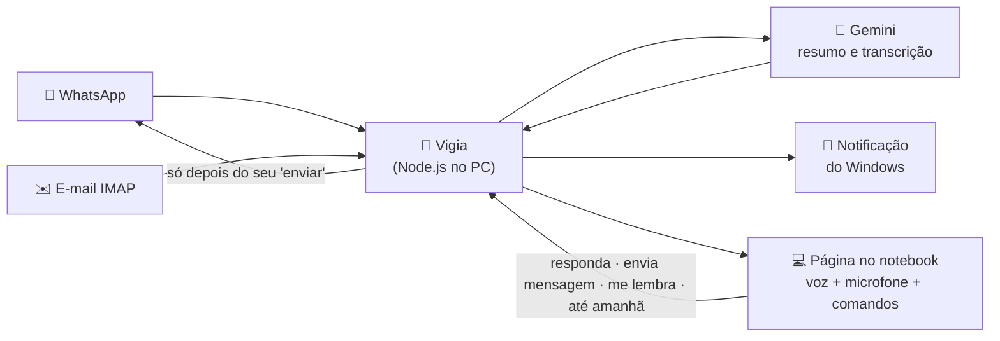

<div align="center">

# 🔮 Vigia

### Seu assistente de voz para WhatsApp e e-mail, rodando no seu próprio PC

Ele lê cada mensagem assim que chega, resume com IA, avisa no Windows e **fala em voz alta**.<br>
Você responde **falando**, e nada sai sem a sua confirmação.

<br>

[](https://github.com/eudollyn/vigia/archive/refs/heads/main.zip)

<br>


</div>

---

## ✨ O que ele faz

| | Recurso | Como funciona |
|---|---|---|
| 💬 | **Lê o WhatsApp** | Conecta como "aparelho conectado" (QR code). Não aparece online e não marca nada como lido. |
| ✉️ | **Lê o e-mail** | IMAP com aviso instantâneo (IDLE). Newsletter e propaganda ficam em silêncio. |
| 🧠 | **Resume com IA** | Cada mensagem vira uma frase curta, com prioridade *urgente*, *normal* ou *baixa*. |
| 🔊 | **Fala em voz alta** | Vozes neurais grátis (Francisca, Thalita, Antonio), com a voz do Windows como reserva. |
| 🎧 | **Transcreve áudios** | Áudios do WhatsApp de até 5 minutos viram texto e resumo. |
| 🗣️ | **Responde por voz** | "Responda" → você dita → ele lê de volta → só envia com "enviar". |
| 📨 | **Envia por voz** | "Envia mensagem para o Thiago dizendo que chego às sete": acha o contato pelo **som do nome**. |
| ⏰ | **Lembretes** | "Me lembra às três de ligar pro cliente", "daqui a 20 minutos", "amanhã de manhã". |
| ☀️ | **Bom dia** | Saudação, data, previsão do tempo e quem ficou sem resposta no WhatsApp. |
| 🌙 | **"Até amanhã"** | Desliga o PC em 15 s (diga "cancela" para desfazer). |
| 💻 | **Notebook como alto-falante** | Uma página no navegador do notebook toca a voz e usa o microfone dele. Não instala nada. |
| 🎵 | **Modo música** | Pausa os comandos contínuos, aumenta a voz e adapta o microfone ao som da música. |
| 🔒 | **Contatos privados** | Para quem você escolher, ele diz só "Mensagem de Fulano", sem ler o conteúdo. |

---

## 🧭 Como funciona



---

## 🚀 Instalação em 5 passos

> **Precisa de:** Windows 10/11, conta Google (para a chave grátis do Gemini) e o WhatsApp no celular.

**1. Baixe e extraia**
Clique no botão verde **⬇ BAIXAR O VIGIA** lá em cima e extraia o `.zip` numa pasta, por exemplo `Documentos\Vigia`.

**2. Rode o instalador**
Dê dois cliques em **`INSTALAR.bat`**. Ele:
- confere o **Node.js** (e oferece instalar, se faltar);
- confere o **ffmpeg** (opcional, para a voz neural e o microfone do PC);
- instala as dependências;
- cria o seu arquivo **`.env`** de configuração;
- pergunta se o Vigia deve ligar junto com o Windows.

**3. Pegue a chave grátis do Gemini**
Em **[aistudio.google.com/apikey](https://aistudio.google.com/apikey)**, clique em **Create API key** e cole a chave no `.env`:
```ini
GEMINI_API_KEY=sua-chave-aqui
```

**4. Configure o e-mail** (opcional)
```ini
EMAIL_USUARIO=voce@suaempresa.com.br
EMAIL_SENHA=sua-senha
IMAP_HOST=imap.seuprovedor.com     # Gmail: imap.gmail.com · Outlook: outlook.office365.com
```
> No Gmail, use uma **senha de app** (Conta Google → Segurança → Senhas de app).

**5. Ligue e conecte o WhatsApp**
Dê dois cliques em **`INICIAR.bat`**. Vai aparecer um **QR code**. No celular, abra **WhatsApp → Aparelhos conectados → Conectar aparelho** e escaneie. Pronto: a conexão fica salva.

---

## 💻 Usar o notebook como alto-falante e microfone (opcional)

Útil quando o PC fica longe ou tem um alto-falante ruim.

1. Quando o Vigia liga, ele mostra o link no terminal e salva em `dados/LINK-DO-NOTEBOOK.txt`, algo como
   `http://192.168.0.10:8765/?k=chave-secreta`
2. Abra esse link no **Chrome do notebook** (na mesma rede Wi-Fi) e clique em **Ativar som e microfone**.
3. **Para liberar o microfone** (uma vez só), porque o Chrome só libera microfone em HTTPS:
   - abra `chrome://flags/#unsafely-treat-insecure-origin-as-secure`;
   - mude para **Enabled** e coloque o endereço do PC, por exemplo `http://192.168.0.10:8765`;
   - clique em **Relaunch**.
4. Se o Windows perguntar, permita o **Node.js** na rede privada.

A página tem céu animado, uma esfera que reage à voz, cartões com os últimos avisos, os botões **Responder**, **🎵 Modo música** e **🌙 Até amanhã** (segure para confirmar).

---

## 🗣️ Comandos de voz

| Diga | O que acontece |
|---|---|
| **"Responda"** | Responde a última mensagem do WhatsApp (dos últimos 15 min). |
| **"Responda: chego às sete"** | Já dita a resposta junto. |
| **"Envia mensagem para o Thiago"** | Pergunta *"Qual mensagem?"*, lê de volta e espera o "enviar". |
| **"Envia mensagem para o Thiago dizendo que…"** | Vai direto para a confirmação. |
| **"Me lembra às três de…"** | Cria um lembrete. Também aceita *"daqui a 20 minutos"* e *"amanhã de manhã"*. |
| **"Até amanhã"** | Despede-se e desliga o PC em 15 s. |
| **"Cancela"** | Cancela o desligamento ou a mensagem que estava sendo confirmada. |
| **"Enviar"** / **"Pode mandar"** / **"Sim"** | Confirma o envio. |

> 🛡️ **Segurança contra disparo acidental:** "até amanhã", "cancela" e "responda" só valem como **frase curta** (até 4 palavras). "Tchau, até amanhã, pessoal" de uma visita não desliga nada.

---

## ⚙️ Configuração (`.env`)

| Variável | Para quê | Exemplo |
|---|---|---|
| `GEMINI_API_KEY` | Resumo, transcrição e lembretes | `AIza…` |
| `EMAIL_USUARIO` / `EMAIL_SENHA` / `IMAP_HOST` | Leitor de e-mail | `imap.gmail.com` |
| `WHATSAPP` | Liga ou desliga o WhatsApp | `1` |
| `VOZ_MICROSOFT` | Voz da assistente | `pt-BR-FranciscaNeural` |
| `SAUDACAO_NOME` | Como ela te chama | `Sr. João` |
| `SILENCIO` | Horário sem voz (só notificação) | `22-7` |
| `BAIXA_PRIORIDADE` | Grupos que só entram no resumo de hora em hora | `Promoções,Condomínio` |
| `PRIVADOS` | Contatos cujo conteúdo não é lido em voz alta | `Mãe,Amor` |
| `SAIDA_VOZ` | Onde a voz toca | `notebook` · `pc` · `ambos` |
| `MICROFONE_ORIGEM` | De onde vem a sua voz | `notebook` · `pc` |
| `CLIMA_CIDADE` / `CLIMA_LAT` / `CLIMA_LON` | Previsão do bom dia | `Recife` / `-8.05` / `-34.9` |

---

## 🔐 Privacidade e segurança

- **Suas senhas e chaves ficam só no `.env`**, que está no `.gitignore` e nunca é enviado.
- **Login do WhatsApp, contatos e histórico** ficam em `dados/`, também fora do Git. Não compartilhe essa pasta.
- **Nada é enviado sem confirmação falada.** O Vigia não responde nem encaminha nada sozinho.
- **O que vai para fora do seu PC:** o texto das mensagens e os áudios vão para o **Google Gemini** (resumo e transcrição). Com o notebook, o **reconhecimento de voz do Chrome** também usa servidores do Google. A previsão do tempo usa a **Open-Meteo** (só a cidade).
- A página do notebook só abre com a **chave secreta** do link.

> ⚠️ **Aviso:** a conexão com o WhatsApp usa a biblioteca não oficial [Baileys](https://github.com/WhiskeySockets/Baileys), o mesmo protocolo do WhatsApp Web. Use com moderação e por sua conta e risco: o WhatsApp não aprova clientes não oficiais.

---

## 🛠️ Solução de problemas

<details>
<summary><b>Não aparece o QR code / o WhatsApp desconectou</b></summary>

Apague a pasta `dados/whatsapp-sessao` e rode o `INICIAR.bat` de novo para gerar outro QR.
</details>

<details>
<summary><b>E-mail: "usuário ou senha recusados"</b></summary>

Confira o domínio do e-mail e o `IMAP_HOST`. No Gmail, use uma **senha de app**. Senhas com `#` funcionam normalmente, desde que fiquem entre aspas: `EMAIL_SENHA="abc#123"`.
</details>

<details>
<summary><b>A voz parou / "cota excedida"</b></summary>

A voz padrão (Microsoft) é grátis e não tem cota. Se você trocou para `VOZ_MOTOR=google`, a cota grátis do Gemini TTS é pequena: volte para `microsoft`.
</details>

<details>
<summary><b>A página do notebook não abre</b></summary>

O notebook precisa estar na mesma rede do PC. Permita o **Node.js** no Firewall do Windows (rede privada).
</details>

<details>
<summary><b>O microfone do notebook não funciona</b></summary>

Faça o passo da flag `unsafely-treat-insecure-origin-as-secure` e recarregue a página. Ela precisa mostrar "🎙️ Microfone".
</details>

<details>
<summary><b>Testar sem esperar mensagem</b></summary>

```bash
npm run teste-aviso        # notificação + voz de exemplo
npm run teste-microfone    # grava uma frase e mostra o que entendeu
```
</details>

---

## 📁 Estrutura

```
vigia/
├── INSTALAR.bat            # instalador guiado
├── INICIAR.bat             # liga o Vigia
├── .env.example            # modelo de configuração
├── scripts/                # notificação, voz, inicialização com o Windows
└── src/
    ├── index.js            # ponto de entrada
    ├── whatsapp.js         # leitura, áudios, busca de contatos por som
    ├── email.js            # IMAP com IDLE
    ├── resumo.js           # resumo e prioridade (Gemini / Claude / simples)
    ├── avisos.js           # notificação, fila de voz, privacidade
    ├── conversa.js         # responder e enviar por voz, com confirmação
    ├── comandos.js         # até amanhã, cancela, lembretes, bom dia
    ├── lembretes.js        # lembretes por voz
    ├── pendencias.js       # conversas sem resposta
    ├── clima.js            # previsão do tempo
    ├── alto-falante.js     # servidor da página do notebook
    └── pagina.html         # a página animada do notebook
```

---

<div align="center">

Feito com ☕ no Brasil · Licença [MIT](LICENSE)

**Se o Vigia te ajudou, deixe uma ⭐ no repositório!**

</div>
